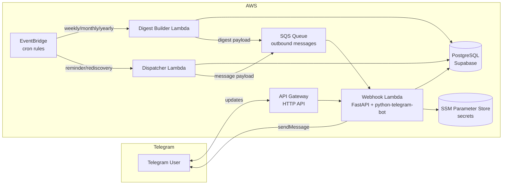

<div align="center">

# 🫙 Gratitude Bot

**A Telegram bot that captures, curates, and resurfaces your gratitude.**

A serverless bot that nudges you to write what you're grateful for, sends weekly/monthly/yearly digests, and surprises you with old entries — like finding a note in a jar.

[](https://github.com/649000/gratitude-bot/actions/workflows/ci.yml)
[](https://www.python.org/downloads/)
[](LICENSE)
[](https://github.com/astral-sh/ruff)
[](https://mypy-lang.org/)

</div>

## What it does

- **Daily gratitude** — send the bot anything you're thankful for; it's saved to your jar.
- **Evening reminders** — a check-in between 7–9pm (your local time) if you haven't written that day.
- **Digests** — weekly (Sunday), monthly (month-end), and yearly (Dec 31) recaps of your highlights.
- **Rediscovery** — a few times a week, plus on-demand `/surprise`, a random past entry resurfaces.
- **Highlight selection** — curated digests via star ratings, length, and entity clustering (no AI required for the base case).
- **Browsing & stats** — `/entries` with pagination, `/star` for favorites, `/stats` for streaks and totals.
- **Export** — `/export` downloads all your entries.
- **Timezone-aware** — location-based detection with a manual `/timezone` override.

## Commands

| Command      | Description                                  |
| ------------ | -------------------------------------------- |
| `/start`     | Onboard, set timezone and preferences        |
| `/grateful`  | Write a gratitude entry                      |
| `/surprise`  | Rediscover a random past entry               |
| `/entries`   | Browse your jar (paged)                      |
| `/star`      | View your starred entries                    |
| `/stats`     | Totals, streaks, and highlights              |
| `/settings`  | Toggle reminders and digests                 |
| `/timezone`  | Set your timezone manually                   |
| `/export`    | Download all entries                         |
| `/help`      | List commands                                |

## Architecture



Two Python Lambdas keep concerns separated:

1. **Webhook Lambda** — receives Telegram updates, processes commands inline, and sends outbound messages (pulled from SQS). Stays lean for fast cold starts (<3s Telegram timeout).
2. **Scheduler Lambda** — two handlers (`digest_builder`, `dispatcher`) triggered by EventBridge cron rules. Heavier queries are isolated from the webhook path.

Secrets (`TELEGRAM_BOT_TOKEN`, `DATABASE_URL`) live in AWS SSM Parameter Store and are injected at cold start. Never committed, never in plain env vars.

## Tech stack

| Layer            | Choice                                                        |
| ---------------- | ------------------------------------------------------------- |
| Language         | Python 3.12                                                   |
| Web framework    | FastAPI (served in Lambda via [Mangum](https://mangum.io/))   |
| Bot framework    | [python-telegram-bot](https://python-telegram-bot.org/)       |
| Database         | PostgreSQL (Supabase) via SQLAlchemy 2 async + asyncpg        |
| Migrations       | Alembic                                                       |
| Compute          | AWS Lambda (arm64)                                            |
| Scheduling       | Amazon EventBridge cron rules                                 |
| Queueing         | Amazon SQS                                                    |
| Secrets          | AWS SSM Parameter Store                                       |
| Infra as code    | Terraform (HCP Terraform backend)                             |
| Observability    | AWS Lambda Powertools (structured logs)                       |
| Tooling          | uv, Ruff, mypy, pre-commit                                    |

## Project layout

```
.
├── src/
│   ├── app/                    # Webhook Lambda (FastAPI app)
│   │   ├── telegram/           #   bot wiring + command handlers
│   │   ├── routers/            #   HTTP routes (health, webhook)
│   │   ├── models/             #   SQLAlchemy models
│   │   ├── schemas/            #   Pydantic schemas
│   │   └── infrastructure/     #   Lambda/Mangum adapter
│   ├── scheduler/              # Scheduler Lambda
│   │   ├── digest_builder/     #   digest generation
│   │   ├── dispatcher/         #   reminder/rediscovery dispatch
│   │   └── common/             #   shared scoring, summarizer, models
│   └── shared/                 # Shared config + SSM (both Lambdas)
├── alembic/                    # Database migrations
├── terraform/                  # Infra (modules + dev/sit/prod environments)
├── tests/                      # pytest suite
├── pyproject.toml              # Project + tool config
└── requirements.txt            # Pinned deps (generated by uv)
```

## Getting started

### Prerequisites

- Python 3.12 and [`uv`](https://docs.astral.sh/uv/)
- PostgreSQL (or Docker)
- A Telegram bot token from [@BotFather](https://t.me/BotFather)

### 1. Install dependencies

```bash
uv sync --extra dev
```

### 2. Configure environment

```bash
cp .env.example .env.dev
```

Set `DATABASE_URL` and `TELEGRAM_BOT_TOKEN` in `.env.dev` (or via SSM when running in AWS).

### 3. Run the database + migrations

Using Docker Compose:

```bash
docker compose up -d db
uv run alembic upgrade head
uv run python src/app/seed.py   # seed prompts
```

### 4. Run locally

```bash
make dev            # uvicorn on :8000 with reload
```

The webhook endpoint is at `POST /api/v1/telegram/webhook`. Health check at `GET /api/v1/health`.

## Testing & quality

```bash
make test           # pytest + coverage
make lint           # ruff check
make format         # ruff format
make format-check   # ruff format --check
uv run mypy .       # strict type checking
```

CI runs lint, typecheck, tests (against a real Postgres service), and a weekly `pip-audit` security scan. `pre-commit` is configured for Ruff + mypy.

## Deployment

Infrastructure is managed with Terraform across three environments (`dev`, `sit`, `prod`) under `terraform/environments/`.

```bash
cd terraform/environments/dev
terraform init
terraform plan
terraform apply
```

Secrets are supplied as Terraform variables (`TF_VAR_*`) and stored as SSM SecureString parameters.